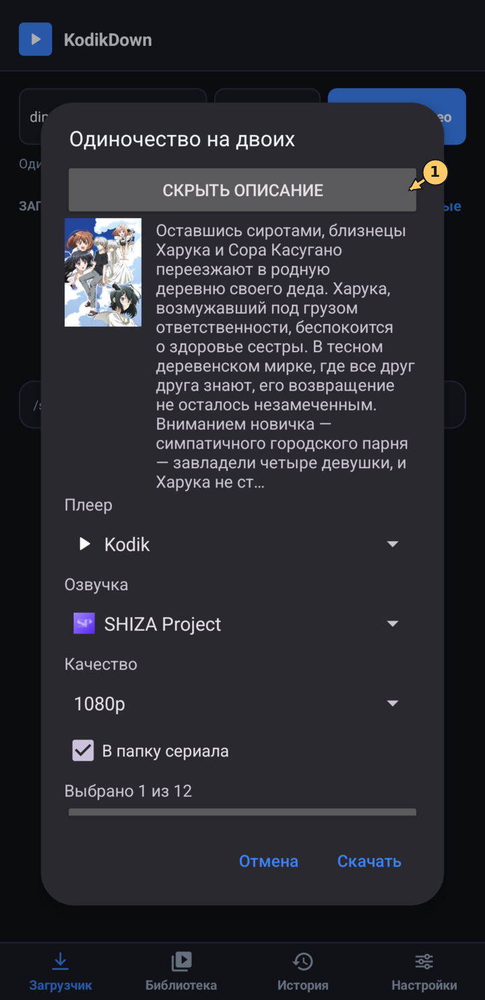
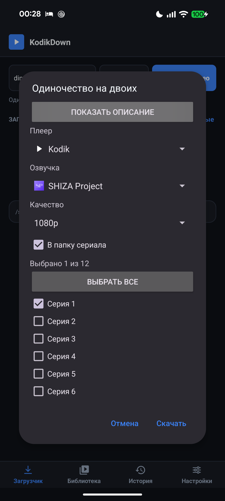

<div align="center">

# KodikDown

**Download anime from a page or player link and watch offline.**

[Download](#download) · [Desktop and Android guide](docs/guide-en.md) · [What's new](CHANGELOG.md) · [Русский](README.md)

[](https://github.com/SHAWNiksDev/kodikdown/releases/latest)
[](https://github.com/SHAWNiksDev/kodikdown/actions/workflows/ci.yml)
[](LICENSE)


</div>

## Download

| Platform | File | Installation |
| --- | --- | --- |
| **Windows 10/11 x64** | [Download EXE](https://github.com/SHAWNiksDev/kodikdown/releases/latest/download/kodikdown-windows-x86_64.exe) | Open the file |
| **Linux x64** | [Download for Linux](https://github.com/SHAWNiksDev/kodikdown/releases/latest/download/kodikdown-linux-x86_64) | Make the file executable |
| **Android 7.0+** | [Download APK](https://github.com/SHAWNiksDev/kodikdown/releases/latest/download/kodikdown-android.apk) | Open the APK on your phone |

> **Upgrading from Android builds older than 4.5.0.** If Android reports a signature conflict, uninstall the old app and install the new APK. This clears app settings and history. Videos in shared storage stay on the device.

On Linux, run `chmod +x kodikdown-linux-x86_64` followed by `./kodikdown-linux-x86_64`. To process HLS on desktop, install **FFmpeg** and check that `ffmpeg -version` runs. On Windows, you can install it with `winget install --id Gyan.FFmpeg -e`.

Get command-line builds and checksums from the [release page](https://github.com/SHAWNiksDev/kodikdown/releases/latest).

## Download episodes

1. Copy the anime page URL and paste it into KodikDown. On Android, you can use **Share → KodikDown** from your browser.
2. Click **Find video**. Choose a player, voice-over, quality and the episodes you want.
3. Click **Download**. Finished episodes appear in **Library**. Use **Save in a series folder** to keep them together on disk.

You can also paste a player link or `<iframe>` embed code into the same field. [Illustrated guide](docs/guide-en.md)

## Supported sources

| What to paste | Support |
| --- | --- |
| Anime page | YummyAnime (including the old site), AnimeGO, AniLiberty, AniDUB |
| Player link or iframe | Kodik, CVH, AniBoom. Desktop also supports Sibnet, Animedia and VK Video |
| Direct link | MP4, HLS (`.m3u8`). Desktop also supports DASH (`.mpd`) |

Episodes, voice-overs and resolutions vary by source. Alloha downloads are currently unavailable. Android supports completed, unencrypted HLS streams with no separate audio track. [Player links and stream formats](docs/guide-en.md#copy-a-player-link)

## Downloads, library and history

- Queue multiple episodes and see progress and speed. Check background downloads in the desktop tray or a silent Android notification.
- Find episodes by series folder and play downloaded files from the library. Copy the original link or retry a download from history.
- Change the theme, language, download folder and default quality in settings.

<p align="center">
  
  
</p>

<details>
<summary>CLI and running from source</summary>

Running from source requires Python 3.11+. Desktop HLS processing requires FFmpeg.

```bash
git clone https://github.com/SHAWNiksDev/kodikdown.git
cd kodikdown
python -m venv .venv
```

Activate the environment with `source .venv/bin/activate` on Linux or `.venv\Scripts\Activate.ps1` in PowerShell.

```bash
python -m pip install .
kodikdown
kodikdown-cli download "<player-link>" -q 720 -o "./Videos"
kodikdown-cli download "<player-link>" --list-qualities
kodikdown-cli download --help
```

Packaged command-line builds have a filename that starts with `kodikdown-` and includes `-cli`.

The CLI downloads one episode per command. Concurrent downloads with the same name use filename suffixes such as `(2)` and `(3)`.

</details>

<details>
<summary>Build and test</summary>

```bash
python -m pip install -e ".[dev]"
ruff check src tests
ruff format --check src tests
mypy
QT_QPA_PLATFORM=offscreen pytest
pyinstaller packaging/kodikdown.spec --noconfirm
pyinstaller packaging/kodikdown-cli.spec --noconfirm
```

In PowerShell, set the test environment variable with `$env:QT_QPA_PLATFORM="offscreen"`. PyInstaller puts the binaries in `dist/`.

Android builds require JDK 17, Android SDK 35 and Build Tools 35.0.0. Set `ANDROID_HOME` or use `android/local.properties` to point Gradle at the SDK.

```bash
bash android/build.sh
```

For testing on a personal phone, pass `-PkodikdownDeviceQa=true` to `assembleDebug` and `assembleDebugAndroidTest`. The `.deviceqa` suffix keeps the test APKs and their data separate from the installed app.

The desktop app and CLI live in `src/kodikdown/`. The Android app lives in `android/app/`. Gradle copies the shared player icons from `src/kodikdown/gui/brands/` at build time.

### Signed Android releases

Signing happens locally. Set `storeFile`, `keyAlias`, `storePassword` and `keyPassword` in `android/keystore.properties` or use the `KODIKDOWN_*` environment variables. Keep the key and passwords out of Git. [Gradle signing configuration](android/app/build.gradle.kts)

1. Match the Python and Android versions and commit the Android source and shared icons.
2. Run `bash android/build.sh --release`. The build embeds the Git tree hashes of `android/` and `src/kodikdown/gui/brands/` in the signed `packaging/kodikdown-android.apk`.
3. Commit the APK. The `v<version>` release tag must include that APK and the same source trees. Changes elsewhere in the repository are fine.

The release workflow matches the embedded hashes to the source trees at the tag and verifies the APK version, signing certificate and build flags. The manual Windows workflow builds the requested tag and stores the files as workflow artifacts.

</details>

## Help

For a 403 or 404 error, click **Find video** again or try a different player or quality. If a desktop download fails during processing, check FFmpeg and available disk space. Include your OS, KodikDown version and steps to reproduce when reporting a problem. [Report an issue](https://github.com/SHAWNiksDev/kodikdown/issues/new)

[MIT License](LICENSE) · [Changelog](CHANGELOG.md)
