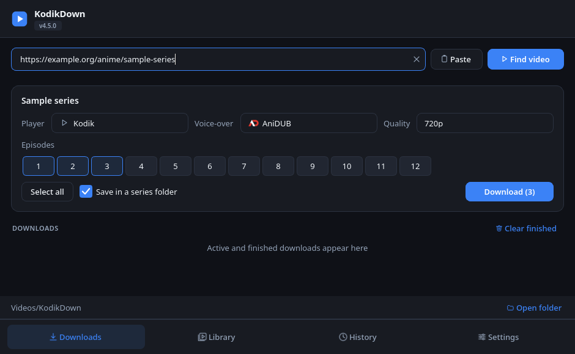

<div align="center">

# KodikDown

**Download anime from a page or player link and watch offline.**

[Download](#download) · [Desktop and Android guide](docs/guide-en.md) · [What's new](CHANGELOG.md) · [Русский](README.md)

[](https://github.com/SHAWNiksDev/kodikdown/releases/latest)
[](https://github.com/SHAWNiksDev/kodikdown/actions/workflows/ci.yml)
[](LICENSE)



</div>

## Download

| Platform | File | Installation |
| --- | --- | --- |
| **Windows 10/11 x64** | [Download EXE](https://github.com/SHAWNiksDev/kodikdown/releases/latest/download/kodikdown-windows-x86_64.exe) | Open the file |
| **Linux x64** | [AppImage](https://github.com/SHAWNiksDev/kodikdown/releases/latest/download/kodikdown-linux-x86_64.AppImage) · [standalone binary](https://github.com/SHAWNiksDev/kodikdown/releases/latest/download/kodikdown-linux-x86_64) | Make the file executable |
| **Android 7.0+** | [Download APK](https://github.com/SHAWNiksDev/kodikdown/releases/latest/download/kodikdown-android.apk) | Open the APK on your phone |

Windows may show a SmartScreen warning when you first open the EXE. Download it from the KodikDown release page and use `SHA256SUMS` to verify the file if needed.

On Android, open the downloaded APK. If prompted to allow installation from this source, open Settings from the prompt and grant permission to the browser or file manager that opened the APK. Install 4.7.1 over the official 4.7.0 APK to keep your history and settings. If Android reports a signature conflict with an older or test build, uninstall it before upgrading. Uninstalling clears app settings and history. Videos in shared storage stay on your device.

The Linux AppImage includes Python and Qt. It targets x86_64 distributions with glibc 2.35 or newer, including Ubuntu 22.04 and Debian 12. Open a terminal in the download folder.

```bash
chmod +x kodikdown-linux-x86_64.AppImage
./kodikdown-linux-x86_64.AppImage
```

If FUSE is unavailable, run `APPIMAGE_EXTRACT_AND_RUN=1 ./kodikdown-linux-x86_64.AppImage`. For HLS and DASH processing on desktop, install **FFmpeg** and check it with `ffmpeg -version`. On Windows, you can install it with `winget install --id Gyan.FFmpeg -e`.

Find command-line builds and `SHA256SUMS` on the [release page](https://github.com/SHAWNiksDev/kodikdown/releases/latest). On Linux, put the download and checksum file in the same folder and run `sha256sum -c --ignore-missing SHA256SUMS`.

## Download episodes

1. Copy the anime page URL and paste it into KodikDown. On Android, you can use **Share → KodikDown** from your browser.
2. Click **Find video**. Choose a player, voice-over, quality and the episodes you want.
3. Click **Download**. Finished episodes appear in **Library**. Use **Save in a series folder** to keep them together on disk.

You can also paste a player link or `<iframe>` embed code into the same field. [Illustrated guide](docs/guide-en.md)

## Supported sources

| What to paste | Support |
| --- | --- |
| Anime page | YummyAnime (including the old site), AnimeGO, AniLiberty, AniDUB |
| Player link or iframe | Kodik, CVH, AniBoom. Desktop also supports Sibnet, Animedia and VK Video |
| Direct link | MP4, HLS (`.m3u8`). Desktop also supports DASH (`.mpd`) |

Episodes, voice-overs and resolutions vary by source. Alloha downloads are currently unavailable. Android supports completed, unencrypted HLS streams with no separate audio track. [Player links and stream formats](docs/guide-en.md#copy-a-player-link)

[Sites tested and download results](docs/site-checks.md)

## Downloads, library and history

- Queue multiple episodes and see progress and speed. Check background downloads in the desktop tray or a silent Android notification.
- Find episodes by series folder and play downloaded files from the library. Copy the original link or retry a download from history.
- On desktop, search the library and history by title, series, or voice-over.
- The queue survives app restarts. The **Queue** menu can pause, resume, and retry downloads. Use a download's menu to move it to the front. Partial downloads resume when the app can verify that the server is still serving the same file or playlist.
- **Save to favorites** remembers the series' player, voice-over, and quality. Open a favorite to refresh the episode list and download missing episodes.
- Downloaded videos open in the built-in player, which remembers your playback position. Use **Open externally** to watch in another player.
- Change the theme, language, download folder and default quality in settings.

<p align="center">
  
  
</p>

<details>
<summary>CLI and running from source</summary>

Running from source requires Python 3.11 or later. HLS downloads on desktop need FFmpeg.

```bash
git clone https://github.com/SHAWNiksDev/kodikdown.git
cd kodikdown
python -m venv .venv
```

Activate the environment with `source .venv/bin/activate` on Linux or `.venv\Scripts\Activate.ps1` in PowerShell.

```bash
python -m pip install .
kodikdown
kodikdown-cli download "<player-link>" -q 720 -o "./Videos"
kodikdown-cli download "<player-link>" --list-qualities
kodikdown-cli download "<anime-page>" --list-episodes
kodikdown-cli download "<anime-page>" --episode 3 --source 2 -q 720
kodikdown-cli download --help
```

Look for `-cli` in the filenames of packaged command-line builds.

The CLI downloads one episode per command. Use the number from `--list-episodes` with `--source` to select a player and voice-over. By default, the CLI selects the first source that has the requested episode. Downloads with the same name use filename suffixes such as `(2)` and `(3)`.

The CLI uses your saved quality and MP4 preferences. Use `--quality`, `--mp4`, or `--no-mp4` to override them for one download.

</details>

<details>
<summary>Build and test</summary>

```bash
python -m pip install -e ".[dev]"
ruff check src tests
ruff format --check src tests
mypy
QT_QPA_PLATFORM=offscreen pytest
pyinstaller packaging/kodikdown.spec --noconfirm
pyinstaller packaging/kodikdown-cli.spec --noconfirm
```

In PowerShell, set the test environment variable with `$env:QT_QPA_PLATFORM="offscreen"`. PyInstaller puts the binaries in `dist/`.

Run `bash packaging/build_appimage.sh` on Linux x86_64 with the Python environment active. The script downloads and verifies the packaging tools. To support Ubuntu 22.04, build on Ubuntu 22.04 as GitHub Actions does.

Android builds require JDK 17, Android SDK 35 and Build Tools 35.0.0. Set `ANDROID_HOME` or use `android/local.properties` to point Gradle at the SDK.

```bash
bash android/build.sh
```

Use the separate `.deviceqa` package when testing on a personal phone. These commands install it and run the checks over ADB.

```bash
cd android
./gradlew -PkodikdownDeviceQa=true installDebug installDebugAndroidTest
adb shell am instrument -w \
  com.shawniks.kodikdown.deviceqa.test/android.test.InstrumentationTestRunner
```

The desktop app and CLI live in `src/kodikdown/`. The Android app lives in `android/app/`. Gradle copies the shared player icons from `src/kodikdown/gui/brands/` at build time.

### Signed Android releases

Signing happens locally. Set `storeFile`, `keyAlias`, `storePassword` and `keyPassword` in `android/keystore.properties` or use the `KODIKDOWN_*` environment variables. Keep the key and passwords out of Git. [Gradle signing configuration](android/app/build.gradle.kts)

1. Match the Python and Android versions and commit the Android source and shared icons.
2. Run `bash android/build.sh --release`. The build embeds the Git tree hashes of `android/` and `src/kodikdown/gui/brands/` in the signed `packaging/kodikdown-android.apk`.
3. Commit the APK. The `v<version>` release tag must include that APK and the same source trees. Changes elsewhere in the repository are fine.

The release workflow matches the embedded hashes to the source trees at the tag and verifies the APK version, signing certificate and build flags. The manual Windows workflow builds the requested tag and stores the files as workflow artifacts.

</details>

## Help

For a 403 or 404 error, click **Find video** again or try a different player or quality. If a desktop download fails during processing, check FFmpeg and available disk space. Include your OS, KodikDown version and steps to reproduce when reporting a problem. [Report an issue](https://github.com/SHAWNiksDev/kodikdown/issues/new)

[MIT License](LICENSE) · [Changelog](CHANGELOG.md)
