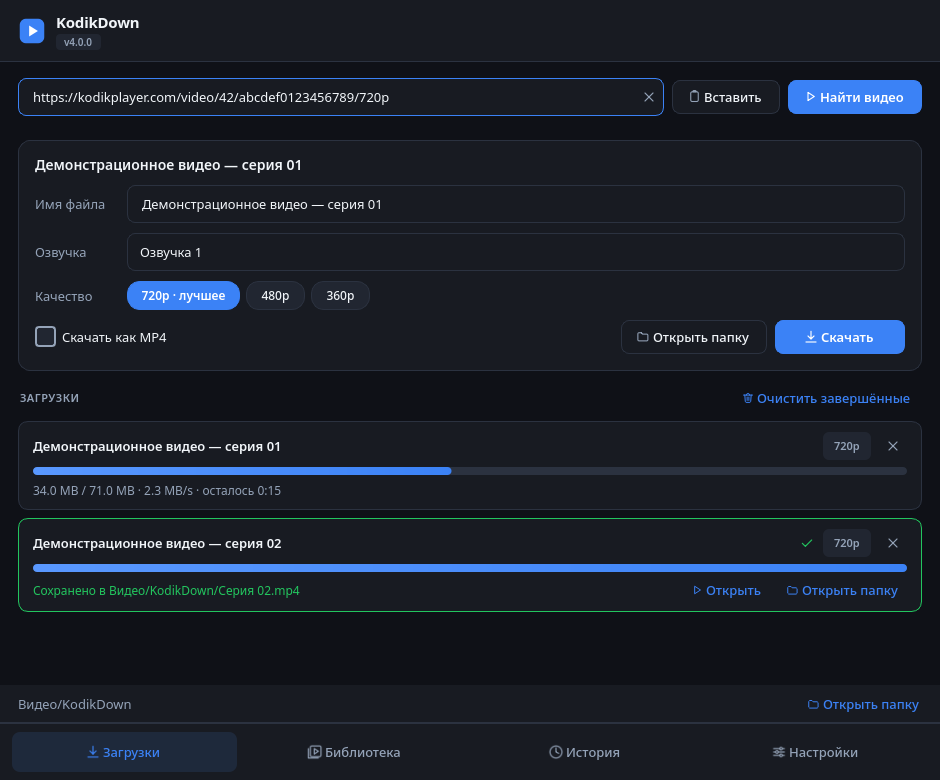
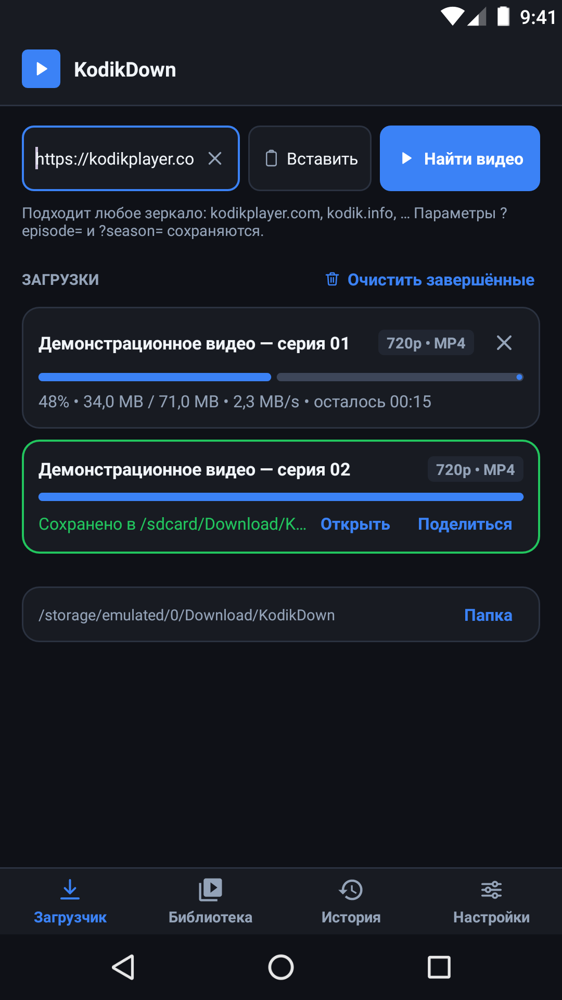
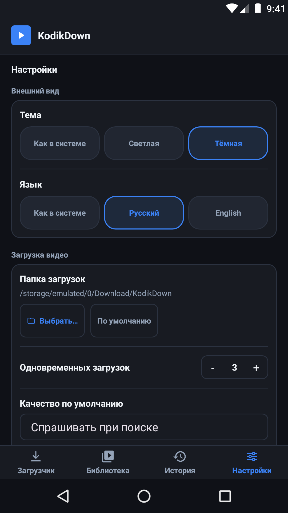

# KodikDown

**Save videos from Kodik players and watch them later, on your phone or computer.**

[Download 4.0.0](https://github.com/SHAWNiksDev/kodikdown/releases/tag/v4.0.0) · [Report a bug](https://github.com/SHAWNiksDev/kodikdown/issues/new) · [Changelog](CHANGELOG.md) · [Русский](README.md)



Paste a player link or its entire `<iframe>`, choose a voice-over and quality, and download the video. There is a desktop app and CLI, plus a native Android app.

## Download

Get the files from [release 4.0.0](https://github.com/SHAWNiksDev/kodikdown/releases/tag/v4.0.0):

| Platform | File |
| --- | --- |
| Android 7.0+ | `kodikdown-android.apk` |
| Linux x64 | `kodikdown-linux-x86_64` |
| Linux x64, CLI | `kodikdown-linux-x86_64-cli` |

```bash
chmod +x kodikdown-linux-x86_64
./kodikdown-linux-x86_64
```

The packaged apps do not require Python. Linux needs a graphical desktop; install **FFmpeg** for HLS processing and check `ffmpeg -version` in a terminal. FFmpeg is not bundled.

Android and Linux were tested for this release. The desktop code is shared with Windows, but a Windows 4.0.0 binary is not included. See the source installation instructions below.

If the Android release will not install over an older test build, uninstall the old app first: the signing certificate has changed. Uninstalling resets settings and history; videos in the shared downloads folder remain. Future releases will keep the same release signing key.

## Use

1. Copy a link to the **Kodik player itself**, or its `<iframe>` code.
2. Paste it and choose Find video.
3. Select a voice-over, quality and optional filename.
4. Download. Finished videos appear in Library.

Links can include `https://`, start with `//`, or be embedded in copied text or Markdown. A cinema page URL is not necessarily a player URL.

## Features

- Quality and voice-over selection from the variants the player provides.
- Concurrent downloads with progress, speed and remaining time when available.
- Retries after network errors and fallback to available lower-quality streams.
- Library, history, original-link copying and confirmation before downloading an existing file again.
- Settings that save immediately, with one small corner indicator.
- English and Russian, light and dark themes.

### Desktop

Downloads, Library, History and Settings share one window. Closing it keeps downloads running in the tray. Choose Quit from the tray menu or press `Ctrl+Q` to exit. Desktops without a tray host minimize the window to the taskbar.

`Ctrl+S` opens settings; `Esc` returns or cancels a lookup. Select completed downloads with `Ctrl` + click. Active tasks are protected from list removal; cancelling uses a separate button and asks for confirmation by default. Transfer settings are locked during lookup and downloads.

<details>
<summary>Light theme and settings</summary>


</details>

### Android

<p align="center">
  
  
  
</p>

Background downloads show a notification. Play or share files through installed apps, choose a folder using the system picker, and select or swipe away completed tasks. Cancellation and deletion confirmations and haptic feedback are available.

Android 7–9 may need storage permission. System-picked folders use their granted access. Force-stopping the app or restarting the device interrupts unfinished transfers; history remains. Manufacturer battery restrictions can affect background downloads.

Screenshots use demonstration data. Their titles, links and paths are examples.

## CLI

Use the installed `kodikdown-cli` command, or `./kodikdown-linux-x86_64-cli` for the packaged Linux binary.

```bash
kodikdown-cli download "<player-link>" -o "./Videos"
kodikdown-cli download "<player-link>" -t "Voice-over" -q 720 -n "Episode 01"
kodikdown-cli download "<player-link>" --list-qualities
kodikdown-cli download "<player-link>" --list-translations
kodikdown-cli download "<player-link>" --print-url -q 480
kodikdown-cli download --help
```

If the requested quality is unavailable, the nearest lower quality is used, or the lowest available variant. Stream links can expire; retry using the original player link.

## Run from source

Requires Python 3.11+, FFmpeg and a graphical desktop for the GUI.

```bash
git clone https://github.com/SHAWNiksDev/kodikdown.git
cd kodikdown
python -m venv .venv
```

Activate with `source .venv/bin/activate` on Linux or `.venv\Scripts\Activate.ps1` in Windows PowerShell. Then:

```bash
python -m pip install .
kodikdown
```

## Development

```bash
python -m pip install -e ".[dev]"
ruff check src tests
ruff format --check src tests
mypy
QT_QPA_PLATFORM=offscreen pytest
pyinstaller packaging/kodikdown.spec --noconfirm
pyinstaller packaging/kodikdown-cli.spec --noconfirm
```

Build output goes to `dist/`. In PowerShell use `$env:QT_QPA_PLATFORM="offscreen"`. Integration tests need a local HTTP server.

Android builds require JDK 17, SDK 35 and Build Tools 35.0.0. Set `ANDROID_HOME` or a local `android/local.properties`.

```bash
bash android/build.sh
bash android/build.sh --release
```

Configure release signing in `android/keystore.properties` using the names in `android/app/build.gradle.kts`. Keys and passwords stay local and are ignored by Git. Back up the key for future updates. GitHub Actions verifies the checked-in signed APK; uploading a private signing key is not required.

## Troubleshooting

For 403/404 errors, resolve the player again or choose a lower quality. For processing errors, check FFmpeg and free disk space. [Open an issue](https://github.com/SHAWNiksDev/kodikdown/issues/new) with the app version, OS and reproduction steps. Include a player link only if it is safe to make public.

Android supports direct MP4 and completed, unencrypted HLS with MPEG-TS or fMP4, including byte ranges. Separate audio tracks, encryption, changing init segments and discontinuities are not supported yet. Desktop processing uses `yt-dlp`. Mirror availability and offered qualities depend on Kodik.

## License

[MIT](LICENSE). This is an independent project. Download only materials you have the right to save.
