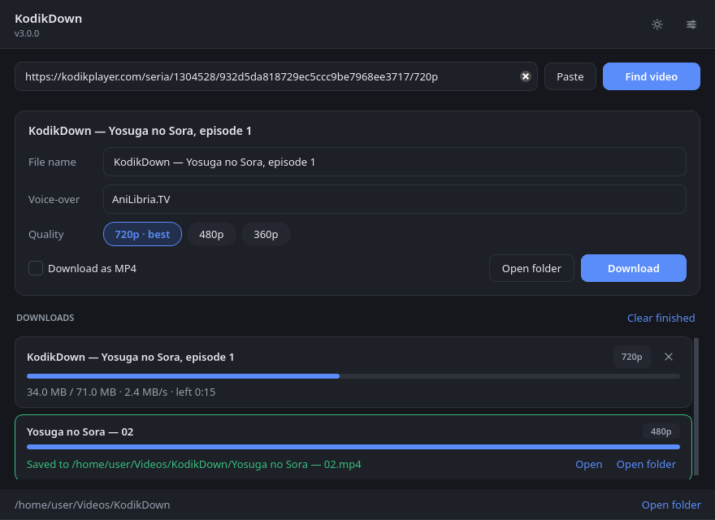
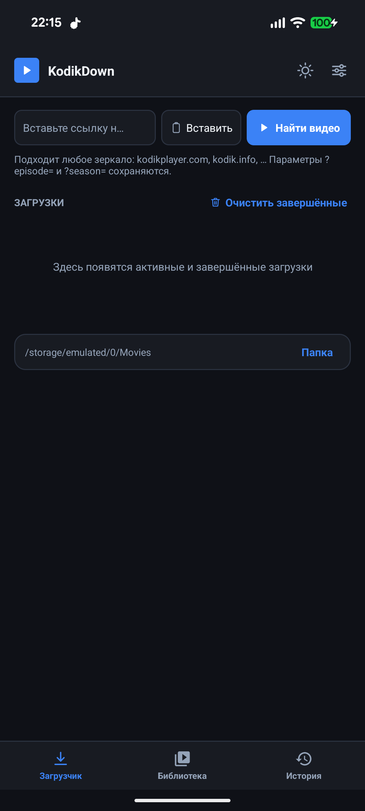
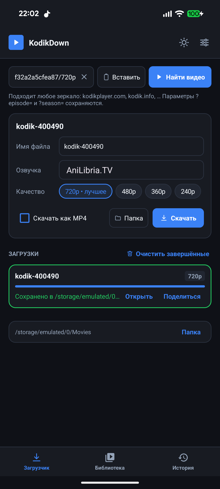
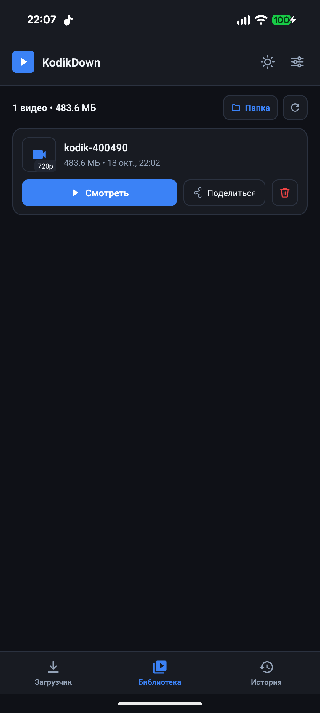
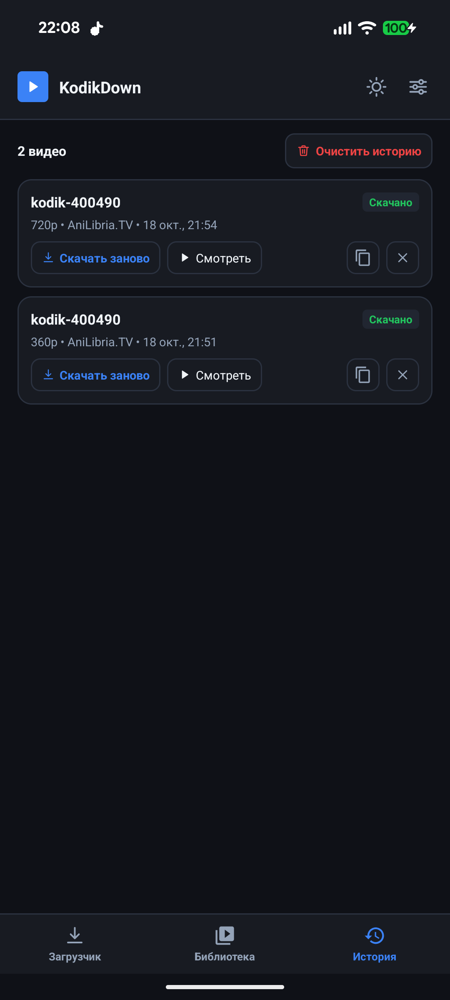

# KodikDown 🇬🇧

[](https://github.com/SHAWNiksDev/kodikdown/actions/workflows/ci.yml)
[](https://github.com/SHAWNiksDev/kodikdown/releases)
[](LICENSE)

A lightweight cross-platform downloader for videos and series hosted on Kodik players. Available as a native Android app, a desktop application for Windows and Linux, and a standalone CLI.

<p align="center">
  
</p>

### Android App

<p align="center">
  
  &nbsp;&nbsp;
  
  &nbsp;&nbsp;
  
  &nbsp;&nbsp;
  
</p>

## Highlights

- **Mobile & Desktop**: Native Android app (Material 3) alongside desktop builds for Windows and Linux.
- **Android Background Downloads**: Uses an Android Foreground Service with WakeLock — downloads keep running when the screen is turned off or while using other apps.
- **Video Library & History**: Dedicated tabs on Android to browse, play offline, share, or delete saved videos, plus a log of all transfers and duplicate download warnings.
- **Direct API Resolution**: Resolves player tokens and decrypts HLS streams on the fly without running a browser instance.
- **Quality Auto-Fallback**: Automatically requests 720p streams, and smoothly steps down to 480p or 360p if CDN nodes restrict high-definition chunks.
- **High-Speed Downloads**: Parallel chunk streaming with an expanded 1 MB socket buffer.
- **Flexible Input**: Paste direct URLs, protocol-relative links, raw `<iframe>` embed codes, or text copied with markdown formatting.
- **Voice-over Selection**: Pick any available translation or dub track offered by the player.
- **Modern Desktop UI**: Dark and light themes matching system preferences, keyboard shortcuts (`Ctrl+S`, `Ctrl+Q`), and live download progress with speed and ETA.
- **Scriptable CLI**: Standalone `kodikdown-cli` binary for automation and headless environments.

## Download & Install

Prebuilt binaries are available on the [Releases](https://github.com/SHAWNiksDev/kodikdown/releases) page:

| Platform | Download | Description |
| --- | --- | --- |
| **Android** | `kodikdown-android.apk` | Native Android app (Android 7.0+) |
| **Windows** | `kodikdown-windows-x86_64.exe` | Desktop GUI for Windows 10/11 |
| **Windows** | `kodikdown-windows-x86_64-cli.exe` | Command-line tool for Windows |
| **Linux** | `kodikdown-linux-x86_64` | Desktop GUI for Linux |
| **Linux** | `kodikdown-linux-x86_64-cli` | Command-line tool for Linux |

### From Source (Python 3.11+)

```bash
pip install .

kodikdown                          # launch the desktop window
kodikdown "<link>"                 # launch window and resolve link immediately
kodikdown-cli download "<url>"     # download directly from terminal
```

## CLI Usage

```bash
# Basic download (default best quality)
kodikdown-cli download "https://kodikplayer.com/seria/1304528/<hash>/720p" -o ~/Videos

# Choose quality and output file name
kodikdown-cli download "<url>" -q 720 -n "Episode_01.mp4"

# Inspect available streams and voice-overs without downloading
kodikdown-cli download "<url>" --list-qualities
kodikdown-cli download "<url>" --list-translations

# Select a specific voice-over by name or number
kodikdown-cli download "<url>" -t AniLibria -q 720

# Output direct decrypted stream URL
kodikdown-cli download "<url>" --print-url -q 720
```

## Building

### Desktop Builds

```bash
pip install -e '.[dev]'
pytest
pyinstaller packaging/kodikdown.spec --noconfirm
pyinstaller packaging/kodikdown-cli.spec --noconfirm
```

### Android APK

```bash
bash android/build.sh
# or via Gradle:
cd android && ./gradlew assembleDebug
```
The APK is saved to `packaging/kodikdown-android.apk`.

## License

MIT License. See [LICENSE](LICENSE) for details.

---

# KodikDown 🇷🇺

[](https://github.com/SHAWNiksDev/kodikdown/actions/workflows/ci.yml)
[](https://github.com/SHAWNiksDev/kodikdown/releases)
[](LICENSE)

Удобный и быстрый загрузчик видео и сериалов с плеера Kodik. Доступен в виде нативного Android-приложения, десктопной программы для Windows и Linux, а также отдельной консольной утилиты.

<p align="center">
  
</p>

### Android-приложение

<p align="center">
  
  &nbsp;&nbsp;
  
  &nbsp;&nbsp;
  
  &nbsp;&nbsp;
  
</p>

## Главные возможности

- **Кроссплатформенность**: Нативное приложение под Android (Material 3) и десктопные сборки для Windows и Linux.
- **Фоновая загрузка на телефоне**: Android Foreground Service с WakeLock — загрузка не обрывается при выключенном экране или переключении между приложениями.
- **Библиотека и история**: Вкладки «Библиотека» (просмотр, отправка в другие приложения, удаление) и «История» всех серий с предупреждением, если файл уже скачивался.
- **Прямая работа с API**: Получение ссылок и расшифровка HLS-потоков на лету напрямую с серверов плеера.
- **Автоматический фоллбэк**: Запрашивает 720p, а если CDN временно отдаёт 404/403 — плавно переключается на рабочие 480p или 360p.
- **Высокая скорость**: Параллельная загрузка фрагментов потока с увеличенным 1 МБ буфером сокетов.
- **Любые ссылки**: Принимает обычные URL, ссылки без протокола, готовый код `<iframe>` и ссылки с Markdown-разметкой.
- **Выбор озвучки**: Поддерживает все доступные в плеере варианты озвучки и перевода.
- **Удобный десктопный интерфейс**: Светлая и тёмная темы, горячие клавиши (`Ctrl+S`, `Ctrl+Q`), параллельные загрузки и открытие папки с готовым видео в один клик.
- **Консольный режим (CLI)**: Быстрая работа через терминал и поддержка скриптов автоматизации.

## Скачивание и установка

Готовые файлы можно скачать в разделе [Releases](https://github.com/SHAWNiksDev/kodikdown/releases):

| Платформа | Файл | Описание |
| --- | --- | --- |
| **Android** | `kodikdown-android.apk` | Нативное приложение (Android 7.0+) |
| **Windows** | `kodikdown-windows-x86_64.exe` | Графический интерфейс для Windows 10/11 |
| **Windows** | `kodikdown-windows-x86_64-cli.exe` | Консольная утилита для Windows |
| **Linux** | `kodikdown-linux-x86_64` | Графический интерфейс для Linux |
| **Linux** | `kodikdown-linux-x86_64-cli` | Консольная утилита для Linux |

### Установка из исходников (Python 3.11+)

```bash
pip install .

kodikdown                          # запуск графического интерфейса
kodikdown "<ссылка>"               # запуск с автопоиском по ссылке
kodikdown-cli download "<ссылка>"  # скачивание через консоль
```

## Примеры команд в терминале

```bash
# Простое скачивание видео
kodikdown-cli download "https://kodikplayer.com/seria/1304528/<hash>/720p" -o ~/Видео

# Задать качество и свое имя файла
kodikdown-cli download "<ссылка>" -q 720 -n "Серия_01.mp4"

# Посмотреть доступные качества и озвучки без скачивания
kodikdown-cli download "<ссылка>" --list-qualities
kodikdown-cli download "<ссылка>" --list-translations

# Выбрать нужную озвучку по названию или номеру
kodikdown-cli download "<ссылка>" -t AniLibria -q 720

# Получить прямую ссылку на расшифрованный манифест
kodikdown-cli download "<ссылка>" --print-url -q 720
```

## Сборка

### Десктопная версия

```bash
pip install -e '.[dev]'
pytest
pyinstaller packaging/kodikdown.spec --noconfirm
pyinstaller packaging/kodikdown-cli.spec --noconfirm
```

### Сборка Android APK

```bash
bash android/build.sh
# или через Gradle:
cd android && ./gradlew assembleDebug
```
Собранный файл будет находиться в `packaging/kodikdown-android.apk`.

## Лицензия

Распространяется под лицензией MIT. Подробнее — в файле [LICENSE](LICENSE).
