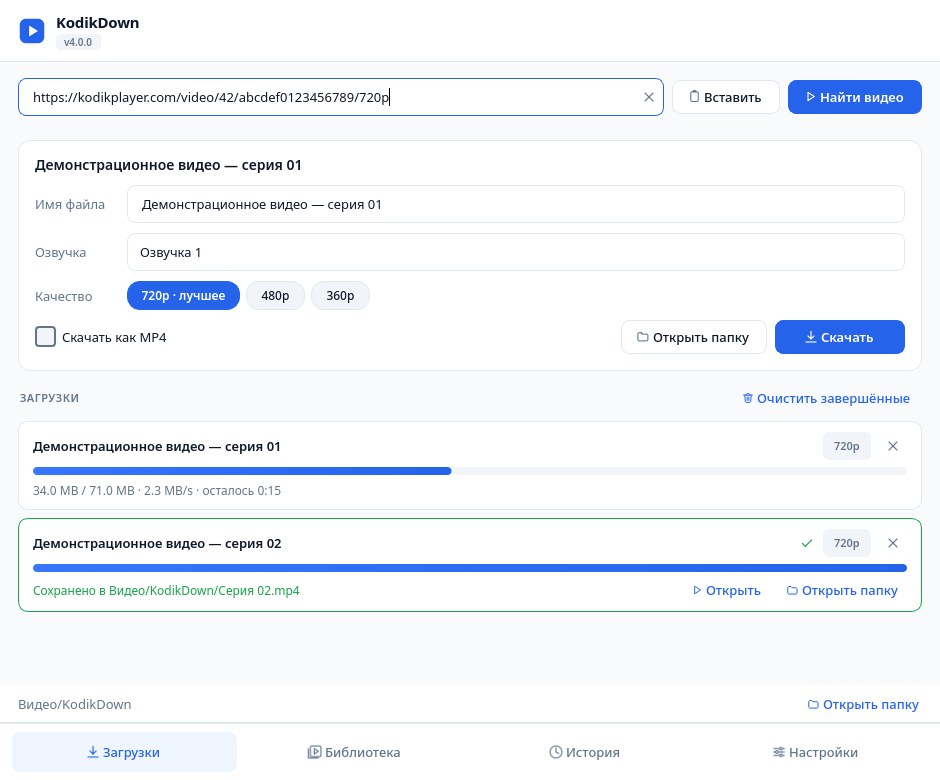
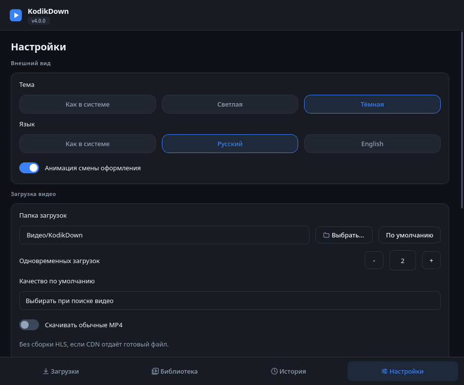
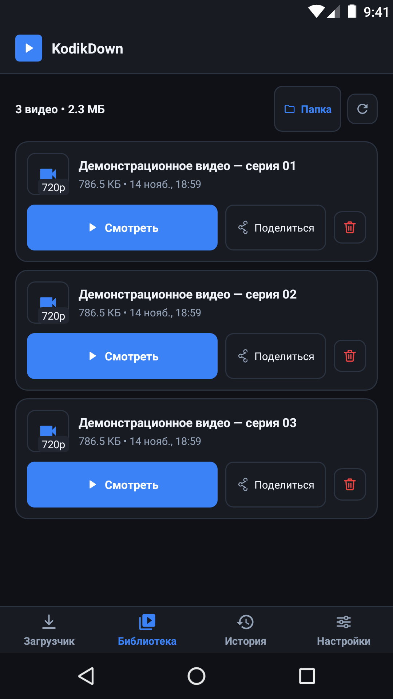

<div align="center">

# KodikDown

**Скачивайте серии с поддерживаемых сайтов и плееров для просмотра офлайн.**

[Скачать 4.5.0](https://github.com/SHAWNiksDev/kodikdown/releases/tag/v4.5.0) · [Сообщить об ошибке](https://github.com/SHAWNiksDev/kodikdown/issues/new) · [Что изменилось](CHANGELOG.md) · [English](README.en.md)

[](https://github.com/SHAWNiksDev/kodikdown/actions/workflows/ci.yml)
[](LICENSE)


</div>

KodikDown принимает ссылку на плеер или целиком его `<iframe>`, находит доступные озвучки и качества и сохраняет выбранное видео. На ПК есть графический интерфейс и консольная версия, на Android — отдельное нативное приложение.

## Скачать и запустить

Сборки для Windows и Linux доступны в [релизе 4.5.0](https://github.com/SHAWNiksDev/kodikdown/releases/tag/v4.5.0).

| Платформа | Файл | Как запустить |
| --- | --- | --- |
| Android 7.0 и новее | [Подписанный APK 4.0.0](https://github.com/SHAWNiksDev/kodikdown/releases/tag/v4.0.0) | Откройте APK и разрешите установку из выбранного источника |
| Windows 10/11 x64 | `kodikdown-windows-x86_64.exe` | Скачайте и откройте EXE |
| Windows x64, консоль | `kodikdown-windows-x86_64-cli.exe` | Запустите из PowerShell или терминала |
| Linux x64 | `kodikdown-linux-x86_64` | Разрешите выполнение файла и откройте его |
| Linux x64, консоль | `kodikdown-linux-x86_64-cli` | Запустите из терминала |

```bash
chmod +x kodikdown-linux-x86_64
./kodikdown-linux-x86_64
```

Для готовых сборок Python не нужен. На Linux нужен графический сеанс. На Windows и Linux для сборки HLS-видео установите **FFmpeg** и проверьте, что `ffmpeg -version` работает в терминале. FFmpeg не включён в исполняемый файл. В Windows можно установить его командой `winget install --id Gyan.FFmpeg -e`, затем открыть приложение заново.

Исходники Android 4.5.0 входят в этот выпуск. Обновление поверх публичного APK требует подписи тем же ключом, которым подписан APK 4.0.0.

## Как пользоваться

Подробные шаги со скриншотами для ПК и Android и подсказки по ссылкам на каждый плеер собраны в [инструкции](docs/guide-ru.md).

### Загрузка серий на ПК

1. Скопируйте адрес страницы аниме с YummyAnime (включая старую версию), AnimeGO, AniLiberty или AniDUB.
2. Вставьте ссылку в KodikDown и нажмите «Найти видео».
3. Выберите плеер, озвучку, качество и отметьте серии. Кнопка «Выбрать все» отмечает весь список.
4. Нажмите «Скачать». У каждой серии будет свой прогресс и запись в истории.

На YummyAnime доступны Kodik и CVH. Плееры, из которых программа пока не скачивает, показаны под списком серий. На AnimeGO плееры и озвучки берутся из первой серии, а доступность выбранного варианта для остальных проверяется при загрузке.

### Загрузка по ссылке на плеер

1. Скопируйте ссылку **на сам плеер Kodik** или его код `<iframe>`.
2. Вставьте её в приложение и нажмите «Найти видео».
3. Выберите озвучку, качество и, если нужно, имя файла.
4. Нажмите «Скачать». Готовое видео появится в библиотеке.

Можно вставлять ссылку с `https://`, без протокола (`//…`), внутри текста или Markdown. На ПК также поддерживаются ссылки на CVH, AniBoom, Sibnet, Animedia, VK Video и прямые ссылки на MP4, HLS и DASH.

## Что умеет приложение

- Выбирать качество и озвучку из вариантов, которые отдаёт плеер.
- Скачивать несколько видео и показывать прогресс, скорость и оставшееся время, когда сервер передаёт нужные данные.
- Повторять запросы после сетевых ошибок; при недоступности качества пробовать доступный вариант ниже.
- Проверять наличие готовых файлов, предупреждать перед повторной загрузкой и сохранять исходную ссылку в истории.
- Применять настройки сразу. Успешное сохранение обозначается маленьким значком в углу, без всплывающей очереди сообщений.
- Работать на русском и английском, в светлой и тёмной теме.

### На компьютере

Четыре вкладки — «Загрузки», «Библиотека», «История» и «Настройки» — находятся в одном окне. Крестик сворачивает приложение в трей, загрузки продолжаются. Для полного выхода выберите «Выйти» в меню трея или нажмите `Ctrl+Q`. Если рабочий стол не предоставляет трей, окно сворачивается на панель задач.

`Ctrl+S` открывает настройки, `Esc` возвращает назад или отменяет поиск. Для выбора нескольких завершённых загрузок используйте `Ctrl` + щелчок. Активные задачи нельзя удалить из списка; отмена выполняется отдельным крестиком с подтверждением. Папка и параметры загрузки блокируются, пока идёт поиск или скачивание.

<details>
<summary>Светлая тема и настройки</summary>




</details>

### На Android

<p align="center">
  
  
  
</p>

Загрузки работают в фоне с уведомлением. Видео можно открыть или отправить через установленные приложения. Папка выбирается через системный диалог; доступны свайпы и выделение завершённых задач, подтверждения отмены и удаления, тактильный отклик.

На Android 7–9 может потребоваться разрешение на хранилище. Для папки, выбранной через системный диалог, используется выданный ей доступ. После принудительной остановки приложения или перезагрузки телефона незавершённую загрузку нужно запустить заново; история сохраняется. Ограничения батареи производителя могут влиять на работу в фоне.

Скриншоты сделаны на демонстрационных данных. Названия, ссылки и пути на них — примеры.

## Консоль

В примерах `kodikdown-cli` — установленная команда. Для готовой Linux-сборки используйте `./kodikdown-linux-x86_64-cli`.

```bash
# Скачать видео в выбранную папку
kodikdown-cli download "<ссылка-на-плеер>" -o "./Videos"

# Указать озвучку, качество и имя файла
kodikdown-cli download "<ссылка>" -t "Озвучка" -q 720 -n "Серия 01"

# Посмотреть доступные варианты
kodikdown-cli download "<ссылка>" --list-qualities
kodikdown-cli download "<ссылка>" --list-translations

# Получить ссылку потока без скачивания
kodikdown-cli download "<ссылка>" --print-url -q 480

kodikdown-cli download --help
```

Если выбранного качества нет, используется ближайшее доступное меньшее, а при его отсутствии — минимальное. Ссылки потока могут истекать: для новой попытки лучше снова использовать исходную ссылку на плеер.

## Запуск из исходников

Нужны Python 3.11+, FFmpeg и графическое окружение для интерфейса ПК.

```bash
git clone https://github.com/SHAWNiksDev/kodikdown.git
cd kodikdown
python -m venv .venv
```

Активируйте окружение: `source .venv/bin/activate` в Linux или `.venv\Scripts\Activate.ps1` в Windows PowerShell. Затем:

```bash
python -m pip install .
kodikdown
# Или:
kodikdown-cli download "<ссылка-на-плеер>"
```

## Разработка

```bash
python -m pip install -e ".[dev]"
ruff check src tests
ruff format --check src tests
mypy
QT_QPA_PLATFORM=offscreen pytest

pyinstaller packaging/kodikdown.spec --noconfirm
pyinstaller packaging/kodikdown-cli.spec --noconfirm
```

Файлы сборки появятся в `dist/`. В PowerShell задайте `QT_QPA_PLATFORM` через `$env:QT_QPA_PLATFORM="offscreen"`. Интеграционным тестам нужен локальный HTTP-сервер.

Для Android нужны JDK 17 и Android SDK 35 с Build Tools 35.0.0. Укажите SDK через `ANDROID_HOME` или локальный `android/local.properties`.

```bash
bash android/build.sh            # тесты, lint и debug APK
bash android/build.sh --release  # подписанный release APK
```

Для релиза настройте `android/keystore.properties` по параметрам из `android/app/build.gradle.kts`. Ключ и пароли хранятся локально и исключены из Git. Сохраните резервную копию ключа: он нужен для последующих обновлений. GitHub Actions проверяет готовый подписанный APK; закрытый ключ туда передавать не требуется.

## Если что-то не работает

При ошибках 403/404 повторите поиск или выберите качество ниже. Для ошибки сборки файла проверьте FFmpeg и свободное место. Если проблема остаётся, [создайте issue](https://github.com/SHAWNiksDev/kodikdown/issues/new): версия приложения, ОС, ссылка на плеер, если её можно публиковать, и шаги воспроизведения помогут разобраться.

Android поддерживает прямой MP4 и завершённые незашифрованные HLS-потоки с MPEG-TS или fMP4, включая диапазоны байтов. Отдельные аудиодорожки, шифрование, смена инициализационных сегментов и разрывы HLS пока не поддерживаются. На ПК обработкой потоков занимается `yt-dlp`. Доступность серий, озвучек и качеств зависит от выбранного сайта и плеера.

## Лицензия

[MIT](LICENSE). KodikDown — независимый проект. Сохраняйте только материалы, на скачивание которых у вас есть право.
