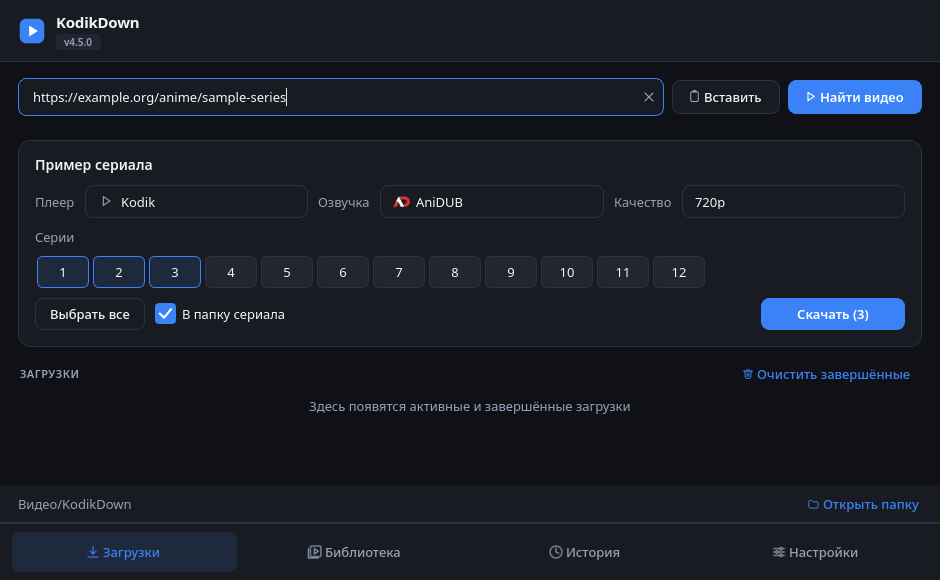
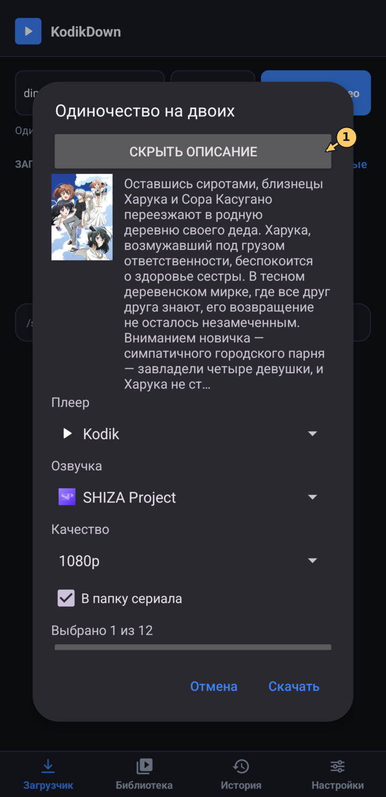
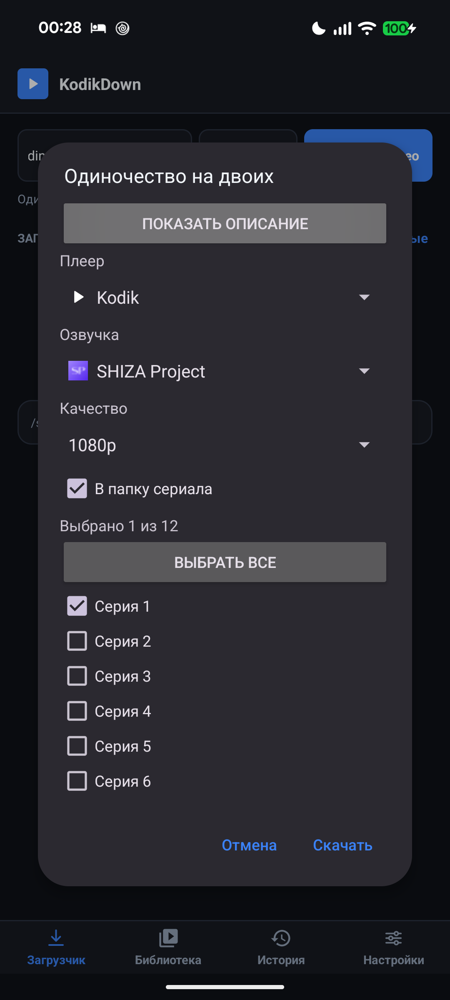

<div align="center">

# KodikDown

**Скачивайте аниме по ссылке на страницу или плеер и смотрите офлайн.**

[Скачать](#скачать) · [Инструкция для ПК и Android](docs/guide-ru.md) · [Что нового](CHANGELOG.md) · [English](README.en.md)

[](https://github.com/SHAWNiksDev/kodikdown/releases/latest)
[](https://github.com/SHAWNiksDev/kodikdown/actions/workflows/ci.yml)
[](LICENSE)



</div>

## Скачать

| Платформа | Файл | Установка |
| --- | --- | --- |
| **Windows 10/11 x64** | [Скачать EXE](https://github.com/SHAWNiksDev/kodikdown/releases/latest/download/kodikdown-windows-x86_64.exe) | Откройте файл |
| **Linux x64** | [Скачать для Linux](https://github.com/SHAWNiksDev/kodikdown/releases/latest/download/kodikdown-linux-x86_64) | Дайте файлу право на запуск |
| **Android 7.0+** | [Скачать APK](https://github.com/SHAWNiksDev/kodikdown/releases/latest/download/kodikdown-android.apk) | Откройте APK на телефоне |

> **Обновление Android со сборок до 4.5.0.** Если Android сообщает о конфликте подписей, удалите старую версию и установите новый APK. История и настройки сбросятся, а видео в общей папке останутся.

На Linux запустите `chmod +x kodikdown-linux-x86_64`, затем `./kodikdown-linux-x86_64`. Для обработки HLS на ПК установите **FFmpeg** и проверьте командой `ffmpeg -version`, что программа доступна. В PowerShell можно установить FFmpeg командой `winget install --id Gyan.FFmpeg -e`.

Консольные сборки и контрольные суммы доступны в [релизе](https://github.com/SHAWNiksDev/kodikdown/releases/latest).

## Как скачать серии

1. Скопируйте адрес страницы аниме и вставьте в KodikDown. На Android можно открыть страницу через **Поделиться → KodikDown**.
2. Нажмите **Найти видео**. Выберите плеер, озвучку, качество и нужные серии.
3. Нажмите **Скачать**. Готовые серии будут в **Библиотеке**. Включите **В папку сериала**, если хотите сохранить их вместе.

Ссылку на плеер или код `<iframe>` можно вставить в то же поле. [Инструкция со скриншотами](docs/guide-ru.md)

## Поддерживаемые источники

| Что можно вставить | Поддержка |
| --- | --- |
| Страница аниме | YummyAnime (включая старую версию), AnimeGO, AniLiberty, AniDUB |
| Ссылка или iframe плеера | Kodik, CVH, AniBoom. На ПК также Sibnet, Animedia и VK Видео |
| Прямая ссылка | MP4, HLS (`.m3u8`). На ПК также DASH (`.mpd`) |

Список озвучек, серий и качеств зависит от источника. Загрузка с Alloha пока недоступна. Android поддерживает незашифрованные завершённые HLS-потоки без отдельной аудиодорожки. [Подробнее о ссылках](docs/guide-ru.md#как-скопировать-ссылку-на-плеер)

## Загрузки, библиотека и история

- Загружайте несколько серий, следите за прогрессом и скоростью. На ПК прогресс виден в трее, на Android — в тихом уведомлении.
- Открывайте скачанные файлы из библиотеки и находите нужную серию по папке. Из истории можно скопировать исходную ссылку или запустить загрузку снова.
- Переключайте светлую и тёмную темы, язык, папку загрузок и качество по умолчанию в настройках.

<p align="center">
  
  
</p>

<details>
<summary>Консоль и запуск из исходников</summary>

Для запуска из исходников нужен Python 3.11+. Для сборки HLS на ПК нужен FFmpeg.

```bash
git clone https://github.com/SHAWNiksDev/kodikdown.git
cd kodikdown
python -m venv .venv
```

Активируйте окружение командой `source .venv/bin/activate` в Linux или `.venv\Scripts\Activate.ps1` в PowerShell.

```bash
python -m pip install .
kodikdown
kodikdown-cli download "<ссылка-на-плеер>" -q 720 -o "./Videos"
kodikdown-cli download "<ссылка-на-плеер>" --list-qualities
kodikdown-cli download --help
```

У готовых консольных сборок имя файла начинается с `kodikdown-` и содержит `-cli`.

CLI скачивает одну серию за вызов. При одновременной загрузке файлов с одинаковым именем новые файлы получают суффиксы `(2)`, `(3)` и так далее.

</details>

<details>
<summary>Сборка и тесты</summary>

```bash
python -m pip install -e ".[dev]"
ruff check src tests
ruff format --check src tests
mypy
QT_QPA_PLATFORM=offscreen pytest
pyinstaller packaging/kodikdown.spec --noconfirm
pyinstaller packaging/kodikdown-cli.spec --noconfirm
```

В PowerShell задайте переменную для тестов через `$env:QT_QPA_PLATFORM="offscreen"`. Готовые сборки PyInstaller появятся в `dist/`.

Для Android нужны JDK 17, Android SDK 35 и Build Tools 35.0.0. Укажите путь к SDK через `ANDROID_HOME` или `android/local.properties`.

```bash
bash android/build.sh
```

Для проверок на личном телефоне добавьте `-PkodikdownDeviceQa=true` к задачам `assembleDebug` и `assembleDebugAndroidTest`. Суффикс `.deviceqa` отделяет тестовые APK и их данные от установленного приложения.

Код ПК и CLI находится в `src/kodikdown/`, код Android в `android/app/`. Иконки источников общие. Gradle копирует их из `src/kodikdown/gui/brands/` при сборке.

### Подписанный Android-релиз

Подпись остаётся локальной. Укажите `storeFile`, `keyAlias`, `storePassword` и `keyPassword` в `android/keystore.properties` или используйте переменные `KODIKDOWN_*`. Храните ключ и пароли вне Git. [Настройки подписи Gradle](android/app/build.gradle.kts)

1. Согласуйте версии Python и Android и закоммитьте исходники Android и общие иконки.
2. Запустите `bash android/build.sh --release`. Скрипт встроит Git SHA деревьев `android/` и `src/kodikdown/gui/brands/` в подписанный `packaging/kodikdown-android.apk`.
3. Закоммитьте APK. Тег `v<версия>` должен указывать на коммит с этим APK и теми же деревьями исходников. Правки в остальной части репозитория допустимы.

Workflow сверяет встроенные SHA с деревьями исходников в теге и проверяет версию, подпись и параметры APK. Ручной Windows workflow собирает файлы для выбранного тега и сохраняет их как артефакты запуска.

</details>

## Помощь

При ошибках 403 или 404 заново нажмите **Найти видео** или попробуйте другой плеер либо качество. Если на ПК не собирается файл, проверьте FFmpeg и свободное место. В отчёте о проблеме укажите ОС, версию KodikDown и шаги, по которым можно повторить ошибку. [Сообщить о проблеме](https://github.com/SHAWNiksDev/kodikdown/issues/new)

[Лицензия MIT](LICENSE) · [История версий](CHANGELOG.md)
