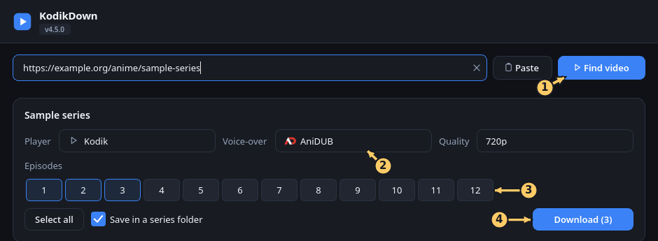
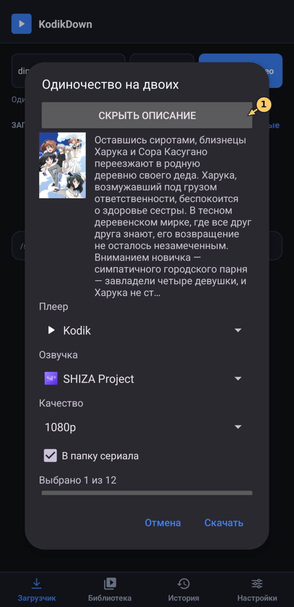
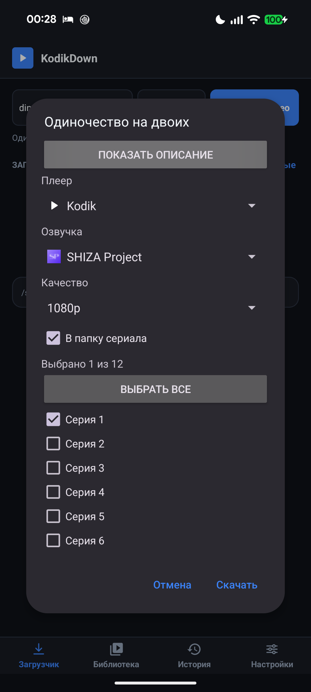
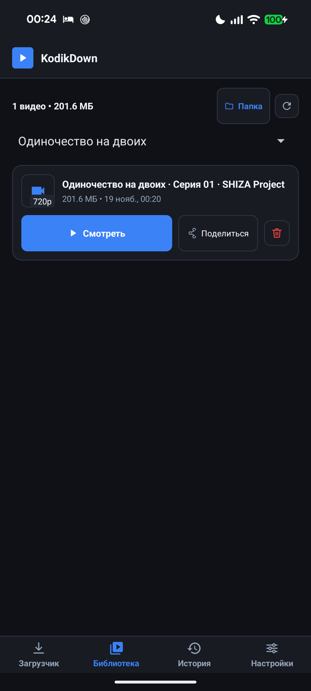
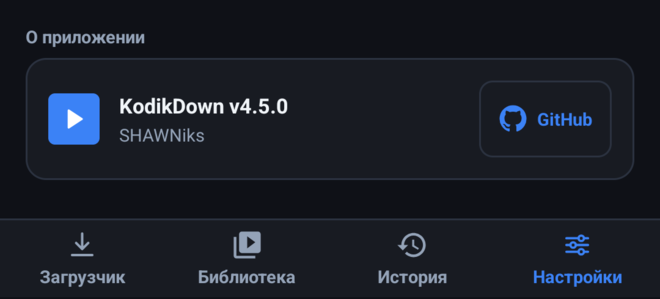
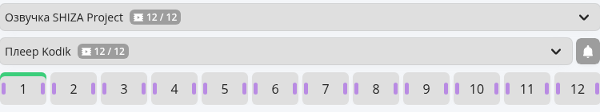

# How to use KodikDown

[Home](../README.en.md) · [Русский](guide-ru.md) · [Download KodikDown](../README.en.md#download)

[Desktop](#desktop) · [Android](#android) · [Player links](#copy-a-player-link)

Copy the anime page URL from your browser. KodikDown supports YummyAnime, including the old site, AnimeGO, AniLiberty and AniDUB. You can paste a player URL, an `<iframe>` embed or a direct video link into the same field.

## Desktop

1. Paste the URL into the top field and click **Find video**.
2. Pick a **Player**, **Voice-over** and **Quality**. Click **Hide description** to collapse the poster and synopsis.
3. Click the episode numbers you want or choose **Select all**. **Save in a series folder** keeps these episodes together inside your download folder.
4. Click **Download**. The number on the button tells you how many episodes you selected.

Finished episodes appear in **Library**. Expand the series folder to see its files. In **History**, you can retry a download or choose **Copy original link**. If you pasted an iframe, the copied link comes from its `src` attribute.

Use the window's close button to keep downloading in the background. If your desktop supports a system tray, KodikDown shows progress in its tray menu. To exit the app, choose **Quit** in the tray or press `Ctrl+Q`.

## Android

1. Open the anime page in your browser and tap **Share → KodikDown**. If you copied the URL, use **Paste → Find video** in the app. Tap **Hide description** to make room for the episode list.
2. Choose a **Player**, **Voice-over** and **Quality**.
3. Scroll down and tick the episodes you want or tap **Select all**. Keep **Save in a series folder** checked to store them together.
4. Tap **Download**. A silent notification shows background download progress.
5. Go to **Library** or **History** and pick a series folder from the list above the entries.

  
  

Allow notifications if you want to see download progress. To change the download folder, open **Settings** and choose a folder in the system picker. On Android 7–9, the app may need storage permission.

Check your installed version

Open **Settings** and scroll to **About**. The version is shown next to KodikDown.

## Copy a player link

Open the anime site's watch section and select the **voice-over (1)**, **player (2)** and **episode (3)**. If the player offers **Copy link** or **Embed code**, copy it and paste it into KodikDown.

### In Chrome on desktop

1. Press **F12** and open **Elements**.
2. Press **Ctrl+F**, search for `iframe` and find the frame inside the video area. On some sites it appears when you select an episode.
3. Double-click the URL in **`src`** and copy it. If it starts with a single `/`, add the site's origin, including `https://`. You can paste a URL starting with `//` as-is.
4. Paste the URL or the full `<iframe …>` tag into KodikDown and click **Find video**.

If the page has many frames, open **F12 → Network → Doc**, then choose the player and episode again. Find the request using the domain or path below and copy **Headers → Request URL**. [Chrome DevTools documentation](https://developer.chrome.com/docs/devtools/network/)

| Player | What to copy |
| --- | --- |
| **Kodik** | The iframe URL with `/seria/…` or `/video/…`. Keep any season and episode parameters. |
| **CVH** | The outer iframe URL with `/iframeCVH.html?anime_id=…&episode=…` or `/cdn-iframe/…`. You can also paste the full CVH statistics, including **United video id** and **URL**. The bare `…/frame/` URL opens the player shell. |
| **AniBoom** | An embed such as `aniboom.one/embed/…`. Keep the `episode` and `translation` parameters. |
| **Sibnet** | A URL such as `video.sibnet.ru/shell.php?videoid=…`. Desktop only. |
| **Animedia** | A player URL such as `aser.pro/vod/…`. Desktop only. |
| **VK Video** | The video URL or the embed code from the **Share** menu, when the uploader allows embedding. Desktop only. |
| **Alloha** | An embed may look like `alloha.yani.tv/?token_movie=…`. It opens the player. Alloha downloads are currently unavailable in KodikDown. |

For AniLiberty and AniDUB, copy the release page URL. On mobile, **Share → KodikDown** is usually the quickest route. To get an iframe URL that the site does not expose in its menu, use the desktop Chrome steps above.

## Direct links and quality

Paste direct **MP4** or **HLS (`.m3u8`)** links into the app. Desktop also supports **DASH (`.mpd`)** and needs FFmpeg to process HLS. Android supports completed, unencrypted HLS with MPEG-TS or fMP4. Separate audio tracks and `EXT-X-DISCONTINUITY` tags are unsupported.

**Original** means the source did not report a resolution up front. If the requested quality is missing, KodikDown chooses the closest lower quality, or the lowest available if all options are higher. Stream URLs can expire. Run **Find video** again with the original link or retry the download from history to get a fresh URL.
