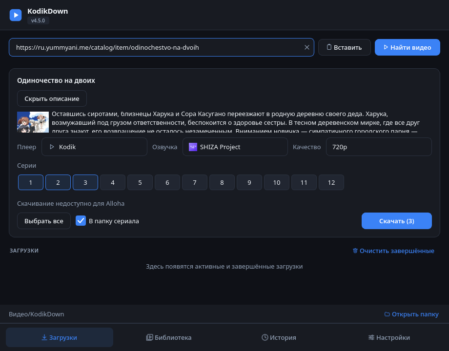
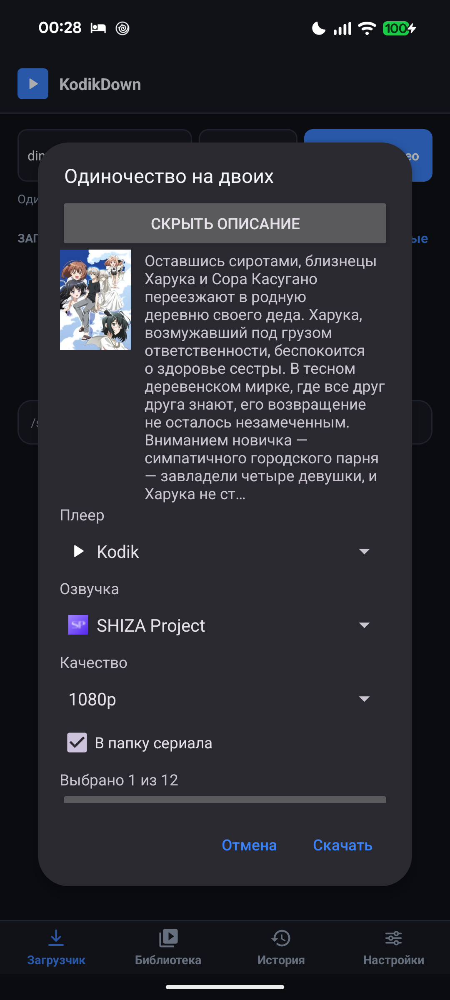
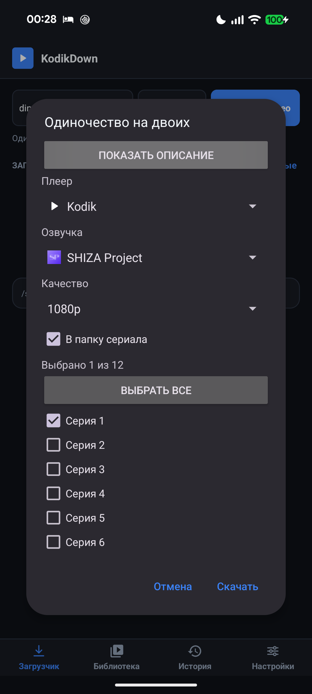
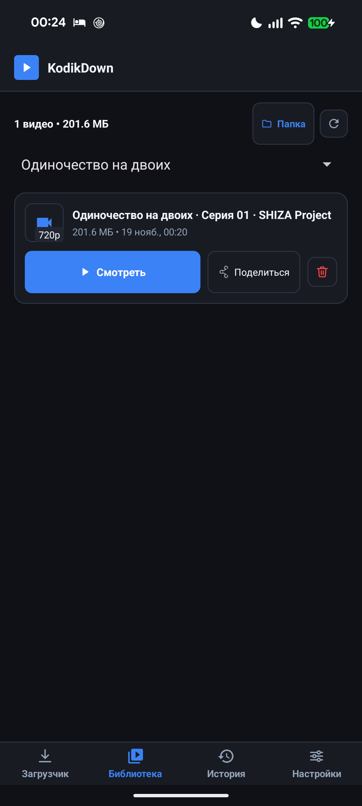

# Как скачать серии в KodikDown 4.5.0

Пример для ПК и Android — **Yosuga no Sora / Одиночество на двоих**. Откройте страницу на YummyAnime и скопируйте адрес из строки браузера. [Одиночество на двоих на YummyAnime](https://ru.yummyani.me/catalog/item/odinochestvo-na-dvoih)

## На ПК

**Страница аниме → Вставить → Найти видео → Плеер и озвучка → Серии → Скачать.**

1. Вставьте адрес страницы в верхнее поле. Нажмите **«Найти видео»**.
2. В поле **«Плеер»** выберите **Kodik**, а в поле **«Озвучка»** — например, **SHIZA Project**. Качество **720p** доступно для этой озвучки. Если у отдельной серии нет выбранного разрешения, программа возьмёт ближайшее доступное ниже.
3. Нажмите на номера нужных серий или **«Выбрать все»**. Число на кнопке **«Скачать»** показывает размер очереди, которую вы добавляете.
4. Оставьте галочку **«В папку сериала»**, чтобы получить папку **«Одиночество на двоих»**. Снимите её, чтобы сохранить файлы прямо в выбранную папку загрузок. Значение по умолчанию можно изменить в **«Настройках»**.

**Скрыть описание** сворачивает постер и текст. **Библиотека → Одиночество на двоих** открывает группу скачанных серий. **История → Скопировать исходную ссылку** копирует адрес страницы аниме или адрес плеера, который был вставлен. Закройте окно крестиком, чтобы оставить загрузки в трее. В меню значка KodikDown отображаются текущая серия и прогресс.

## На Android

**Страница аниме → Поделиться → KodikDown → Плеер и озвучка → Серии → Скачать.**

1. В браузере нажмите **«Поделиться»** и выберите **KodikDown**. Можно также скопировать адрес и открыть **«Вставить → Найти видео»** в приложении.
2. В карточке **«Одиночество на двоих»** выберите **Kodik → SHIZA Project → 720p**.
3. Нажмите **«Скрыть описание»** или прокрутите окно до списка. Отметьте серии и нажмите **«Скачать»**. Галочка **«В папку сериала»** работает так же, как на ПК.
4. В **«Библиотеке»** и **«Истории»** выберите папку сериала в списке над видео. Откройте шторку Android, чтобы посмотреть прогресс фоновой загрузки.

## Как скопировать ссылку на отдельный плеер

У плеера есть свой адрес внутри страницы. Сначала откройте **«Смотреть» → выберите озвучку → выберите плеер → нажмите номер серии**. Можно также вставить адрес страницы аниме прямо в KodikDown и выбрать всё в одном окне.

### В Chrome на ПК

1. Нажмите **F12 → Elements (Элементы)**. Нажмите **Ctrl+F**, введите `iframe` и найдите фрейм внутри области видео. Он может появиться только после выбора серии.
2. Разверните найденный тег и дважды щёлкните по значению **`src`**. Скопируйте адрес. Если он начинается с `//`, добавьте `https:`. Для пути, который начинается с одного `/`, добавьте адрес страницы сайта.
3. Вставьте адрес или целый тег **`<iframe …>`** в KodikDown. Когда поделитесь такой записью из истории, приложение скопирует адрес из `src`. [Chrome DevTools](https://developer.chrome.com/docs/devtools/dom/)

| Плеер | Где искать адрес |
| --- | --- |
| **Kodik** | Выберите Kodik у Yosuga no Sora. Ищите `iframe` с адресом вида `https://kodikplayer.com/seria/…` или `/video/…`. Сохраняйте параметры адреса, если в нём указаны сезон или серия. |
| **CVH** | Выберите CVH и скопируйте внешний `iframe` с `/iframeCVH.html?anime_id=…&episode=…` или `/cdn-iframe/…`. Если уже скопировали статистику плеера, вставьте её целиком. KodikDown использует строку **`United video id`** вместе с адресом CVH из строки **`URL`**. Один адрес `…/frame/` ведёт к оболочке. Для Yosuga no Sora публичный список CVH при проверке оказался пустым, поэтому для этого тайтла используйте Kodik. |
| **Alloha** | Выберите Alloha и ищите внешний `iframe` с адресом вроде `alloha.yani.tv/?token_movie=…`. Этот адрес открывает плеер. Загрузка именно из iframe Alloha в KodikDown пока недоступна. |
| **AniBoom** | На сайте, где доступен AniBoom, ищите `aniboom.one/embed/…`. Оставьте `episode` и `translation` из ссылки. |
| **Sibnet** | Ищите `video.sibnet.ru/shell.php?videoid=…`. Загрузка из iframe доступна на ПК. |
| **Animedia** | Ищите встраиваемый проигрыватель с адресом `aser.pro/vod/…`. Загрузка из iframe доступна на ПК. |
| **VK Видео** | Используйте адрес видео или скопируйте код из меню **«Поделиться → Экспортировать»**, если автор разрешил встраивание. Этот плеер доступен на ПК. |
| **AniLiberty и AniDUB** | Скопируйте адрес страницы самого релиза. KodikDown найдёт список серий на сайте или через API. |

Если в Elements много фреймов, откройте **F12 → Network (Сеть) → Doc (Документ)**, снова выберите серию и плеер. Найдите запрос с тем же доменом и путём, которые указаны в таблице. Нажмите на строку запроса → **Headers → Request URL**. Ссылки на видеофрагменты могут истекать, для повторной загрузки лучше сохранять ссылку на исходную страницу или плеер. [Вкладка Network в Chrome](https://developer.chrome.com/docs/devtools/network/)

### Если вы на телефоне

Выбор серий удобнее делать уже в KodikDown через **«Поделиться»**. Если сайт или плеер предлагает **«Скопировать ссылку»** или **«Код для вставки»**, вставьте результат в приложение тем же способом. Если доступна только страница и нужно именно значение `src`, откройте её на компьютере и используйте шаги с Elements. Для CVH подходит и полный текст статистики плеера с **`United video id`**.

### Прямые ссылки

Если у вас уже есть ссылка на **MP4** или **HLS (.m3u8)**, вставьте её прямо в KodikDown. Когда у ссылки одно разрешение, качество определяется самим файлом. На ПК также доступны совместимые **DASH (.mpd)**. На Android поддерживаются MP4 и завершённые HLS-потоки без шифрования и отдельной аудиодорожки.
