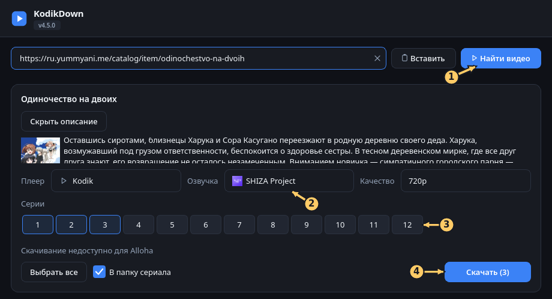
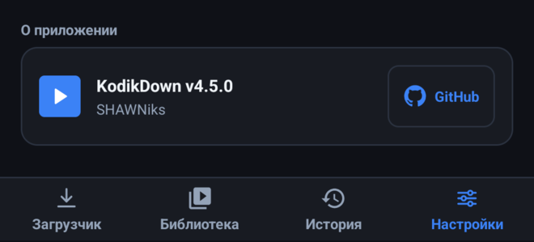
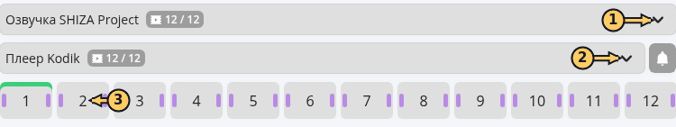

# Как пользоваться KodikDown

[Главная](../README.md) · [English](guide-en.md) · [Скачать KodikDown 4.5.0](https://github.com/SHAWNiksDev/kodikdown/releases/tag/v4.5.0)

[На ПК](#на-пк) · [На Android](#на-android) · [Ссылки на плееры](#как-скопировать-ссылку-на-плеер)

Скопируйте адрес страницы аниме из браузера. Подойдут страницы YummyAnime, включая старую версию, AnimeGO, AniLiberty и AniDUB. Ссылку на отдельный плеер, код `<iframe>` или прямую ссылку на видео можно вставить в то же поле.

## На ПК

1. Вставьте адрес в верхнее поле и нажмите **Найти видео**.
2. Выберите **Плеер**, **Озвучку** и **Качество**. Кнопка **Скрыть описание** сворачивает постер и текст.
3. Щёлкните по нужным сериям. Кнопка **Выбрать все** отмечает весь список. Галочка **В папку сериала** сохраняет серии в отдельной папке внутри папки загрузок.
4. Нажмите **Скачать**. Число на кнопке показывает, сколько серий вы отметили.

Готовые серии появятся в **Библиотеке**. Раскройте папку сериала, чтобы увидеть её содержимое. В **Истории** можно повторить скачивание или нажать **Скопировать исходную ссылку**. Для вставленного iframe скопируется адрес из поля `src`.

Чтобы убрать окно с экрана во время загрузки, закройте его крестиком. При наличии трея KodikDown продолжит работу и покажет прогресс в меню значка. Для полного выхода используйте **Выйти** в трее или `Ctrl+Q`.

## На Android

1. Откройте страницу аниме в браузере и нажмите **Поделиться → KodikDown**. Если скопировали адрес, в приложении нажмите **Вставить → Найти видео**. В карточке можно нажать **Скрыть описание**, чтобы быстрее добраться до списка.
2. Выберите **Плеер**, **Озвучку** и **Качество**.
3. Прокрутите карточку и отметьте серии. Кнопка **Выбрать все** отмечает весь список. Чтобы сохранить серии вместе, оставьте галочку **В папку сериала**.
4. Нажмите **Скачать**. Прогресс фоновой загрузки виден в тихом уведомлении.
5. Откройте **Библиотеку** или **Историю** и выберите папку сериала в списке над записями.

  
  

Если Android предлагает разрешить уведомления, согласитесь, чтобы видеть прогресс в шторке. Папку для сохранения можно выбрать в **Настройках**. На Android 7–9 может понадобиться разрешение на доступ к хранилищу.

Где проверить версию приложения

Откройте **Настройки**, прокрутите до **О приложении**. Версия указана рядом с названием KodikDown.

## Как скопировать ссылку на плеер

Если нужен конкретный плеер, откройте раздел **Смотреть** на сайте. Выберите **озвучку (1)**, **плеер (2)** и **серию (3)**. Если появилось меню **Копировать ссылку** или **Код для вставки**, скопируйте его содержимое и вставьте в KodikDown.

### В Chrome на ПК

1. Нажмите **F12** и откройте **Elements (Элементы)**.
2. Нажмите **Ctrl+F**, введите `iframe` и найдите тег внутри области видео. На некоторых сайтах iframe появляется после выбора серии.
3. Дважды щёлкните по адресу внутри **`src`** и скопируйте его. Если он начинается с одного `/`, добавьте домен сайта. Ссылку с `//` можно вставить как есть.
4. Вставьте адрес или весь тег `<iframe …>` в KodikDown и нажмите **Найти видео**.

Если на странице много фреймов, откройте **F12 → Network → Doc**, снова выберите плеер и серию, затем найдите запрос по домену из таблицы ниже. Нажмите на запрос и скопируйте **Headers → Request URL**. [Документация Chrome DevTools](https://developer.chrome.com/docs/devtools/network/)

| Плеер | Что копировать |
| --- | --- |
| **Kodik** | Адрес iframe с `/seria/…` или `/video/…`. Оставьте параметры сезона и серии, если они есть. |
| **CVH** | Внешний iframe с `/iframeCVH.html?anime_id=…&episode=…` или `/cdn-iframe/…`. Можно также вставить весь текст статистики CVH, включая строки **United video id** и **URL**. Адрес `…/frame/` сам по себе открывает оболочку плеера. |
| **AniBoom** | Адрес вида `aniboom.one/embed/…`. Оставьте параметры `episode` и `translation`. |
| **Sibnet** | Адрес вида `video.sibnet.ru/shell.php?videoid=…`. Поддерживается на ПК. |
| **Animedia** | Адрес встраиваемого плеера вида `aser.pro/vod/…`. Поддерживается на ПК. |
| **VK Видео** | Ссылку на видео или **Поделиться → Экспортировать**, если автор разрешил встраивание. Поддерживается на ПК. |
| **Alloha** | Адрес iframe может выглядеть как `alloha.yani.tv/?token_movie=…`. Этот адрес открывает плеер. Скачивание с Alloha в KodikDown пока недоступно. |

Для AniLiberty и AniDUB достаточно скопировать адрес страницы релиза. На телефоне обычно проще передать страницу через **Поделиться → KodikDown**. Если нужен именно iframe и сайт его не показывает, скопируйте адрес через Chrome на ПК по шагам выше.

## Прямые ссылки и качество

Готовый адрес **MP4** или **HLS (`.m3u8`)** можно вставить в приложение. На ПК также поддерживается **DASH (`.mpd`)**. Для сборки HLS на ПК нужен FFmpeg. На Android поддерживаются завершённые незашифрованные HLS-потоки с MPEG-TS или fMP4 и без отдельной аудиодорожки.

**Исходное** означает, что разрешение задаёт сам источник. Если выбранного разрешения нет, KodikDown попробует ближайшее доступное ниже. Если загрузка перестала открываться, заново найдите видео по исходной ссылке. Адреса потоков могут истекать.
